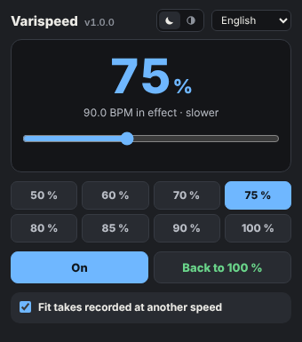
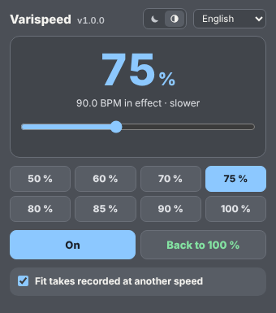

# Varispeed for LUNA

Slow the whole session down, or speed it up, without changing its pitch. Record a difficult
part (a guitar solo, a fast run) at 75 %, then play it back at normal speed, in time with
everything else.

  
  

## Features

- **Session speed from 25 % to 150 %**, keeping the pitch. It uses LUNA's own session speed,
  so every track, instrument and MIDI part follows.
- **Presets** at 50, 60, 70, 75, 80, 85, 90 and 100 %, and a slider for anything in between.
- **On/Off** to compare with the normal speed without losing your setting, and **Back to
  100 %**.
- **Takes fitted by themselves:** a take recorded at another speed is set to follow the tempo
  as soon as you stop recording, so it plays in time at every speed. Cmd+Z in LUNA undoes it.
- **Effective tempo** shown live (for example *90.0 BPM in effect* at 75 % of 120 BPM).
- **Dark and grey themes.**
- **7 languages:** English, Español, Català, Français, Deutsch, Italiano and Português.

## How to use it

1. Open **Varispeed** and pick a speed, say 75 %.
2. Arm a track and record as usual.
3. Stop. The take is fitted to the tempo (the window says so for a few seconds).
4. Press **Back to 100 %**: the take plays at normal speed, at its pitch, in its place.

Tip: for a solo instrument, LUNA's *Monophonic* or *Soloist* warp algorithm on the track
usually sounds better than *Polyphonic* once the take is sped up.

If you close the window with the speed changed, the session stays at that speed until you set
it back to 100 %.

An Add On cannot process audio: the time-stretch is LUNA's own.

## Support

If something does not work as expected, Alt-click the version number at the top of the window:
it copies a short report to paste in a message to fedetrillo@gmail.com.

## Install

Requires LUNA 3.1.2 or later. Install it from LUNA's Add On marketplace, or download
`varispeed.lunaaddon` from the latest release and double-click it. Then open a session and
choose **Add Ons > Windows > Varispeed**.

## En español

Ralentiza (o acelera) toda la sesión sin cambiar el tono, con la velocidad de sesión de LUNA.
Graba un solo difícil al 75 % y escúchalo luego a velocidad normal, a tempo con todo lo demás:
las tomas grabadas a otra velocidad se cuadran solas al terminar. Botones de velocidad,
deslizador fino, activar/desactivar, volver a 100 %, modo oscuro y gris, y 7 idiomas.

## Licence

Copyright (c) 2026 Fede Trillo. All rights reserved. Free to install and use in LUNA; the code
may not be copied, modified or redistributed. See [LICENSE](LICENSE). The bundled LUNA Builder
SDK is Universal Audio's, under the Apache License 2.0: see
[THIRD_PARTY_NOTICES.md](THIRD_PARTY_NOTICES.md).

Contact: fedetrillo@gmail.com
